# Punisher

A control system for an art installation: a Raspberry Pi runs the schedule, a
set of ESP32 devices carry it out, and a web interface lets a supervisor see and
steer what is happening. The installation goes on show in a museum in 2027, as
the subject of a discussion about society, the psyche and freedom.

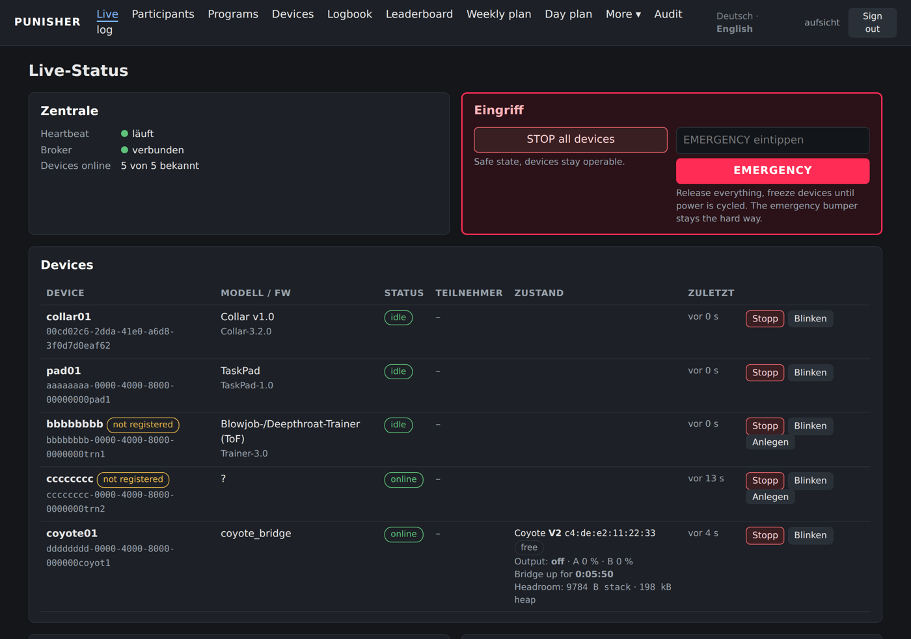

---

## ⚠ Read this first

**This is research work. It is not built for regular use, and it is not a
product.**

It was written to be exhibited and argued about, not to be operated. Parts of it
deliver electrical stimulation to a person's skin, hold someone in place with
electromagnets, and decide when either of those happens. That is the subject
matter, and it is why this repository exists in public: the argument is easier
to have when the mechanism is on the table.

If you are thinking of putting it into service, please don't. Concretely:

- **Nothing here has been assessed for safety by anyone qualified to do so.** No
  certification, no medical review, no risk assessment beyond what one maker
  could think of alone.
- **The hard stop is not in this repository.** The installation's real emergency
  stop is an electrical bumper that cuts mains power, independent of software,
  Wi-Fi and the central unit. Everything in here is the *soft* layer above it.
  A software emergency stop that has to travel over a network is a convenience,
  never a guarantee.
- **Electrical stimulation belongs nowhere near the chest, the head, or anyone
  with an implanted device.** The waveform generator in here does not know where
  its electrodes are.
- **It assumes a supervisor is present, awake, and in the room.** Every design
  decision in this codebase was taken on that assumption. Remove it and the
  assumptions stop holding.

The project documentation says the same thing, at greater length and in German.
This English README is the short version.

---

## What it is

| Part | What it does |
|---|---|
| **Central unit** | A Raspberry Pi. Reads RFID, runs the day plan, decides consequences, keeps the logbook, talks MQTT. |
| **Web interface** | What the supervisor sees: participants, devices, programs, calibration, rules, the live view. |
| **Display** | An HDMI screen the participant sees: current task, time left, rank. |
| **Devices** | ESP32 boards on a shared firmware base — collar, magnetic lock, e-stim bridge, task pad, trainer. |
| **Bench** | Fake devices and end-to-end test scripts. Nothing reaches hardware untested. |

### The supervisor's view

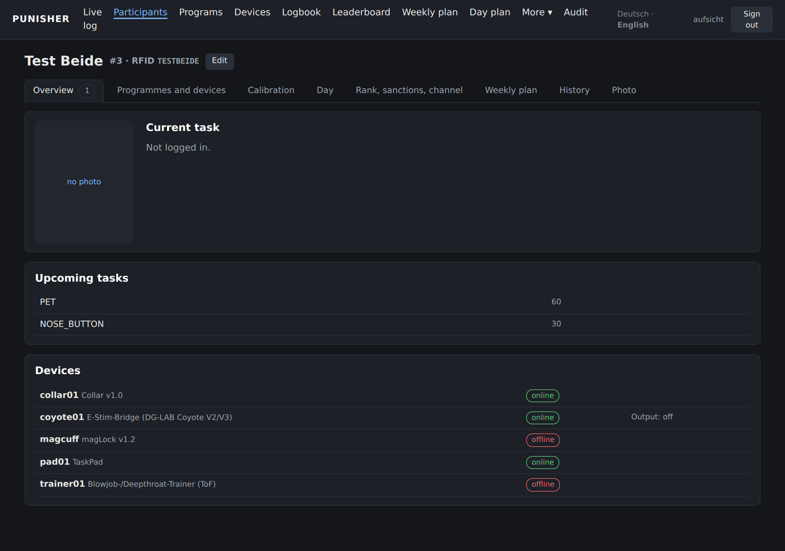

Photo, current task, what comes next, and what her devices are doing. Rank,
points and sanctions live on their own cards — this one answers "what is
happening right now" and nothing else.

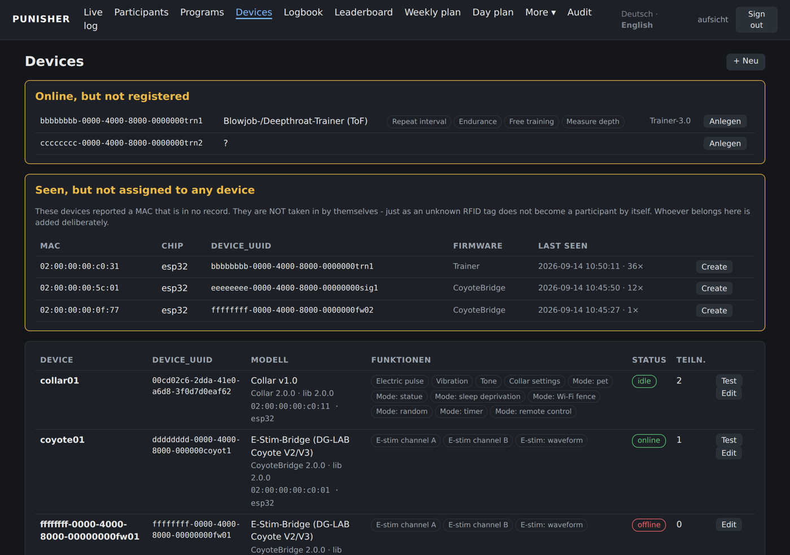

Every device with its MAC, chip type, both firmware versions and whether its MAC
write protection has been burned. A device that reports in but belongs to no
record is shown separately and waits to be assigned by hand — it is never taken
in automatically.

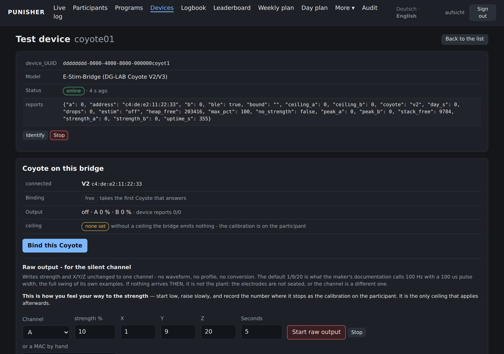

Each device can be exercised on its own, with the limits it reports itself
rather than the ones the catalogue assumes.

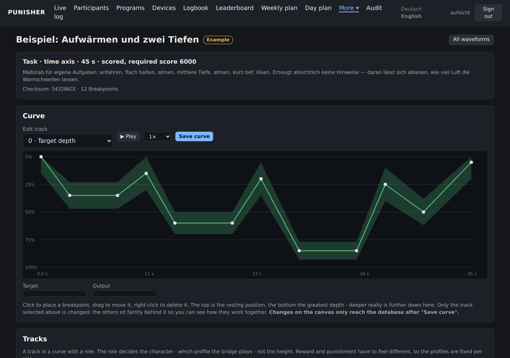

Stimulus and task waveforms are drawn, not coded. The reference waveforms ship
with the installation, because comparing against something that works teaches
more than any help text.

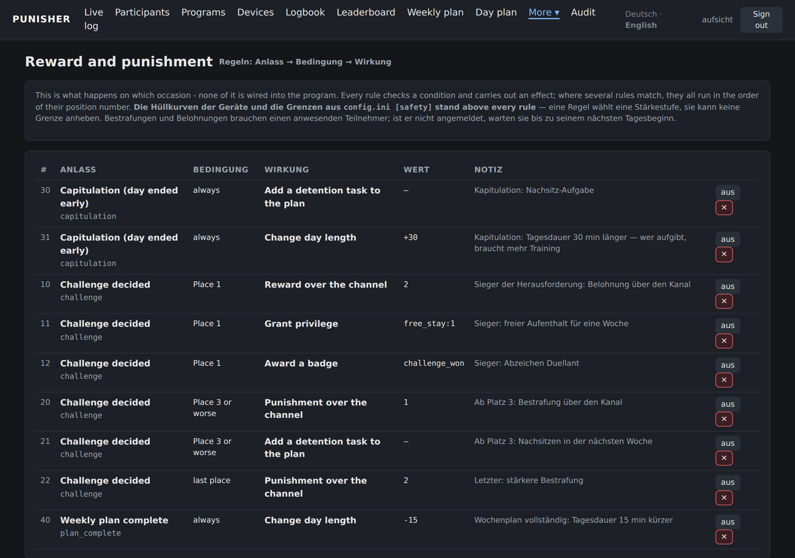

What happens on which occasion is a rule, not a branch in the code. The
conditions on offer are only the ones that can fit the chosen occasion — a
placement exists only where something was placed.

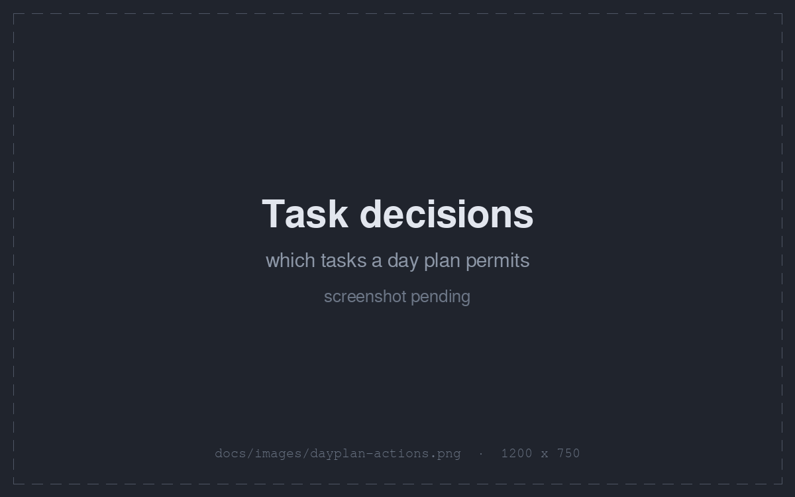

Free training is the one place where the installation reaches into its own
catalogue, and this is where somebody says what it may reach for. A task can be
forbidden outright, only inside a time window, or everywhere except inside one
— sleep deprivation between 22:00 and 06:00 and nowhere else. Everything on
that screen can only make a day smaller.


A mystery block draws a moment and an entry out of its pool; the screen shows
"?" until then, and the audit log says beforehand what was drawn. The pool is
the safety boundary — only what stands in it and is allowed for that person
anyway.

---

## The hardware

> The photographs below are placeholders until the real ones are taken.

| | |
|---|---|
| 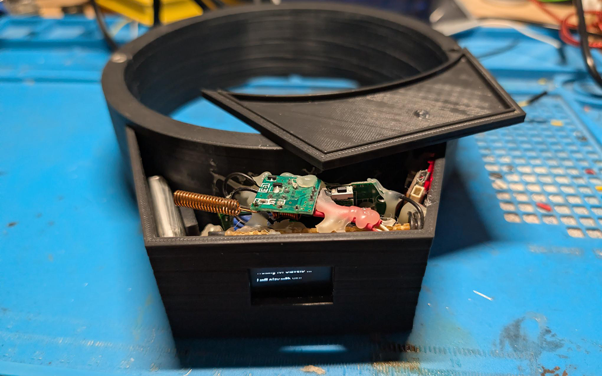 | 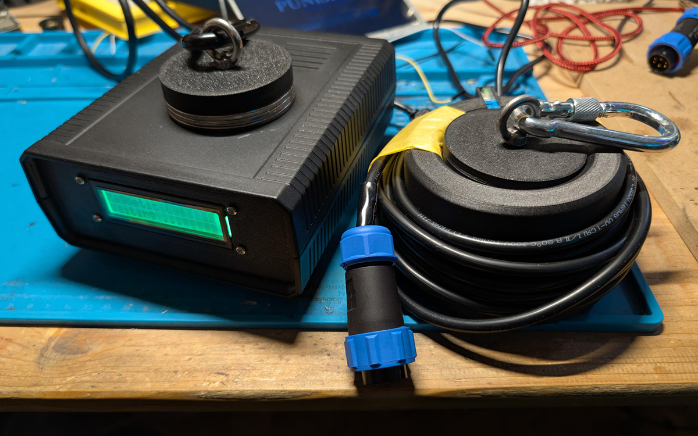 |
| **Collar** — ESP32 with OLED, accelerometer and a 433 MHz transmitter driving an off-the-shelf training collar. | **MagLock** — electromagnets that hold a person's cuffs. Power off means open, always. |
| 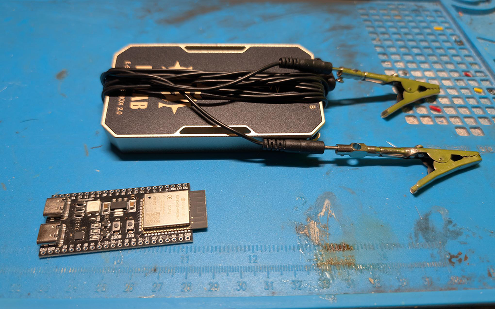 | 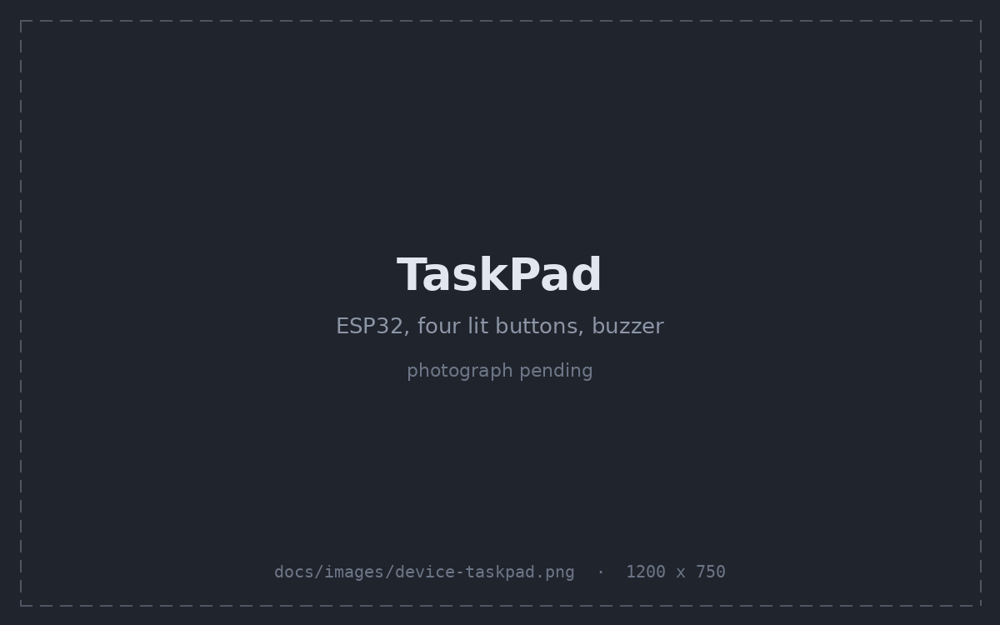 |
| **E-Stim Bridge** — an ESP32 as BLE central for a DG-LAB Coyote, streaming a waveform from its own memory. | **TaskPad** — lit buttons, a vibration motor and a buzzer. Tasks that need attention, not endurance. |
| 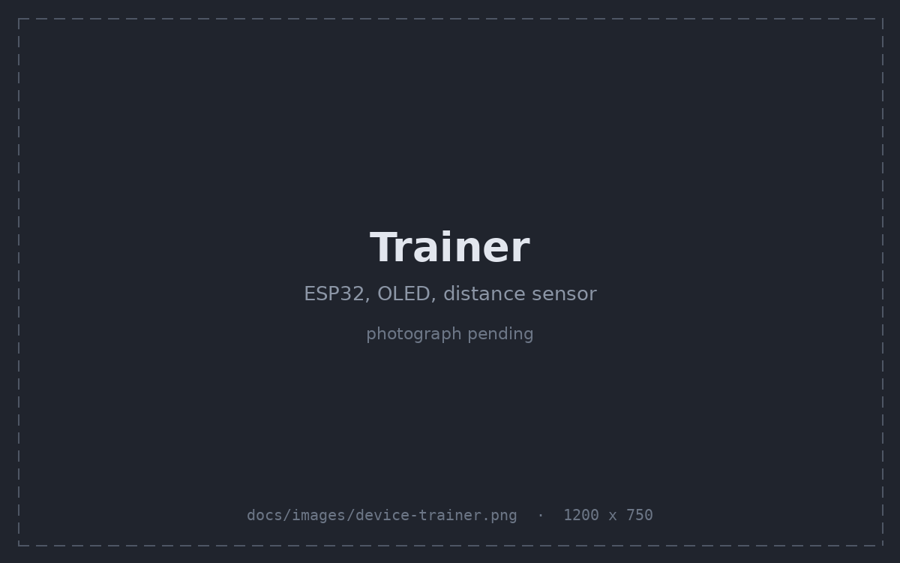 | 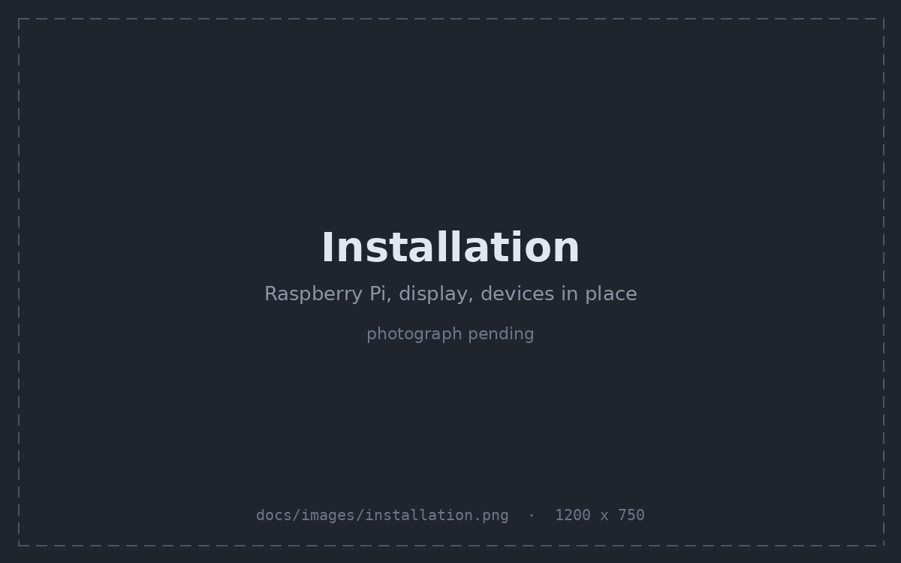 |
| **Trainer** — a time-of-flight sensor measuring depth, with a waveform coupled to the measurement. | **The installation** as it stands. |

---

## How it is put together

**Every device is the same underneath.** `PunisherDevice` is an Arduino library
that handles Wi-Fi, MQTT with a last will, the heartbeat, the command envelope
with a time-to-live, the emergency stop, over-the-air updates and a hardware
watchdog. A device supplies a handler with two obligatory methods: make yourself
safe, and carry out an action.

**The central unit is the only publisher that matters.** Devices report events;
the central unit decides what follows from them. There is exactly one
device-to-device path in the whole system, and it was removed on purpose.

**Boot is always safe.** No device resumes what it was doing. If the central
unit goes quiet for two minutes during an action, the device makes itself safe
on its own. If the broker goes away, the same.

### Identity and versions (2.0)

A device's UUID is **derived**, not typed in:

```
UUID = SHA-256( namespace || efuse MAC || chip type ), UUIDv5 form
```

That removes a step somebody could forget when flashing, and it means the MAC
and the address can no longer drift apart. It protects against **mistakes, not
against tampering** — firmware you have changed can report whatever it likes.

The central unit keeps **two minimum versions per model**: one for the framework
and one for the sketch. Below either, the device is refused and takes no
commands; above the floor but behind the current release, it runs and says so.
Two floors and not one, because a freshly flashed framework with an old sketch
slips straight through a single floor — and on a stimulus bridge that is
firmware writing the channel register by the old contract while the central unit
assumes the new one.

### Signed messages

Every message that acts on a device, or claims something about one, carries an
HMAC-SHA256 signature over the topic and the body:

```json
{"v": 1, "sig": "<64 hex>", "body": "<the exact JSON string that was signed>"}
```

The body is transmitted as the string that was signed, so there is nothing to
canonicalise. Signing a JSON *object* instead would require both sides to agree
forever on key order, whitespace and escaping — which works for years and then
breaks silently when one side changes its JSON library.

The topic goes into the hash. Without it, a command for device A could be
captured and replayed at device B: the same valid signature, a different person
at the other end.

**The emergency stop is deliberately unsigned**, in both directions. Switching
off is the harmless direction; an emergency stop that fails a signature check
would be the dangerous one.

### Encryption is optional, and says which of three states it is in (2.3)

Central unit, web interface and display talk to the broker over localhost; the
devices come over the WLAN, and on that path everything used to be in the
clear — including the broker password on every connect. TLS closes that, in
three states: **off** (clear text, and the default of this repository, so that
a rebuild runs without a certificate having to exist first), **encrypted**
(the certificate is not checked — that protects against listening in, not
against active redirection), and **checked** (a pin on exactly one
certificate). `tools/mqtt_tls.sh` produces that certificate in one command;
there is deliberately no certificate authority, because whoever rebuilds this
should not have to understand one first.

Every process logs which of the three it is running in, and a configuration
that asks for TLS and cannot get it raises rather than falling back to clear
text. What no state changes is authorisation: every command is signed either
way, so even an attacker who becomes the endpoint cannot give an order.

On the device side the handshake is bounded by the task watchdog rather than
by the library default. `setSocketTimeout()` limits what the MQTT client waits
for, not the TLS handshake underneath it, and that one defaults to 120
seconds — long enough for a broker that accepts the connection and then goes
quiet to hold up `loop()` until the watchdog reboots the device. The firmware
derives the handshake limit from `wdtSeconds` instead, and prints it at
startup.

### Limits stack, they never widen (2.3)

The central unit knows a handful of things that shape a day beyond the plan
itself: **budgets and cooldowns** (how often, how close together), **pauses**
(a week that stands), **streaks** (counters that fire triggers when they reach
a milestone or break — the loss is shown, on purpose), a **rule set** with
time conditions, a **day form** (easy / normal / strict, for one day, then back
to normal), **mystery blocks** (the central unit draws inside a pool and a
window; the screen shows "?", the audit log knows beforehand) and
**scenarios** (a named bundle of the above, with an end date).

One rule holds across all of them: a building block may tighten a limit, it
may never widen one. The channel's day limit from `config.ini [safety]` is a
synthetic row among the budgets and wins whenever it is the tighter one; a
strict day form scales pulses up to — and is capped at — her calibrated
ceiling; a mystery draw picks only among what would be allowed at that moment
anyway. Every piece is a table the supervisor edits over the web and a module
that answers one question in one place; none of it reaches the firmware.

---

## Running it

Requirements: a Raspberry Pi with MariaDB and Mosquitto, Python 3.9 or newer.

```bash
cd central
python3 -m pip install -r requirements.txt
cp config/config.ini.example config/config.ini   # then edit it
mysql punisher < sql/001_baseline.sql
mysql punisher < sql/002_seed_konfiguration.sql
mysql punisher < sql/003_wellenformen.sql
python3 punisher-web.py
```

The installation starts with ranks, scoring, a day plan, a rule set and five
reference waveforms — and with **no participants, no devices and no
calibrations**. Those are entered deliberately, because a guessed number in any
of those fields ends up on someone's skin.

For the devices: open `firmware/PunisherDevice` in the Arduino IDE, fill in
`creds.h`, and start with the **SelfTest** example. It checks that the chip
computes the same hashes as the central unit before anything else is flashed.

---

## Repository layout

```
central/       the Raspberry Pi side: scheduler, web interface, display, schema
firmware/      the Arduino library and one sketch per device
tools/         release tooling, including the credential scrubber
docs/          images for this file
licenses/      third-party licence texts
```

The web interface is bilingual. German is the master language; the English
strings live in `central/libs/lang_en.py`. Loanwords that are established in
German stay as they are — it is a *bridge*, not a *Brücke*.

---

## License

**Devious City License 1.0 or later** — see [LICENSE.md](LICENSE.md).

```
SPDX-License-Identifier: LicenseRef-Devious-City-1.0-or-later
```

Use it, study it, build it, modify it, use it commercially. If you share or
publicly operate a modified version, share the corresponding source.

Third-party material keeps its own terms; they are listed at the end of
[LICENSE.md](LICENSE.md).

## Contributing

Please read [CONTRIBUTING.md](CONTRIBUTING.md) first — especially the part about
how patches find their way in, and what is expected of a change that touches
anything safety-relevant. It is short, and it will save you an evening.
